# SmartSear

A closed-loop smart cooking system built on an ESP32. A thermocouple under the pan and a
probe in the meat measure temperature. A controller turns the stove knob with a stepper
motor to hold the pan at a target temperature. Live data reaches a mobile app that guides
the cook step by step, and the system fails safe when a sensor faults or the pan overheats.


## What it does

- **Two temperature inputs:** a Type K thermocouple on the pan and an NTC thermistor
  probe in the food.
- **Closed-loop heat control:** a PI controller turns the stove knob through a stepper
  motor to hold a target pan temperature.
- **Guided cooking:** the app walks the cook through preheat, sear, flip, second sear and
  rest. It adjusts its timers from live probe data.
- **Fail-safe behavior:** if the pan overheats or a sensor disconnects, the knob is
  driven to its lowest setting and the LCD shows the fault. The app also raises a
  full-screen alarm when the pan gets too hot.
- **Nutrition tracking:** the app logs macros from UPC barcode scans or a food-database
  search.

## Architecture

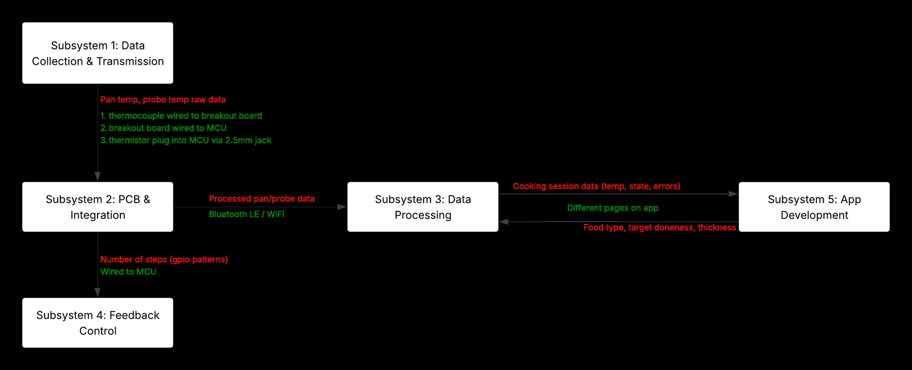

| Subsystem | Responsibility |
| --- | --- |
| Data collection | Thermocouple and thermistor sensing, calibration |
| PCB and power | Custom ESP32-S3 board, 5 V input, 3.3 V LDO rail, sensor and display connectors |
| Feedback control | PI control of pan temperature through a stepper-driven stove knob |
| Data processing | BLE decoding, filtering, feature extraction, cooking state machine, fault detection |
| Mobile app | Guided cooking, live temperatures, alerts, recipes, macro tracking |

### Data path

The board talks Bluetooth Low Energy (BLE) to a host computer. The host runs the data
pipeline and serves the results to the phone over WebSocket.

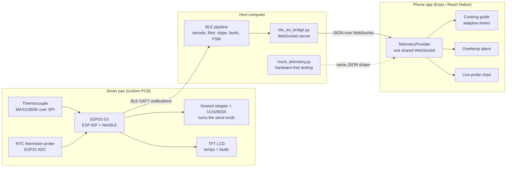

The firmware and the host-side data pipeline are in a companion repo,
[`sophiezhou1/ece-design`](https://github.com/sophiezhou1/ece-design). This repo holds the
mobile app and the host tools that connect the two.

### Hardware


*This block diagram is from the design stage. The built system uses a geared stepper
motor in place of the servo shown.*

| Component | Part | Interface |
| --- | --- | --- |
| Microcontroller | ESP32-S3-WROOM-1 (N8R8) | BLE to the host |
| Pan sensor | Type K thermocouple + MAX31855K amplifier breakout | SPI |
| Food sensor | NTC thermistor probe (2.5 mm jack), 100 kΩ voltage divider + RC filter | ADC |
| Actuator | 28BYJ-48 geared stepper via ULN2803A driver, 3D-printed knob mount | GPIO step patterns |
| Display | 320×240 color TFT LCD | SPI |
| Power | 5 V wall adapter, AP2112K-3.3 LDO regulator | |

## Custom PCB

| Schematic | Layout | Assembled |
| --- | --- | --- |
| 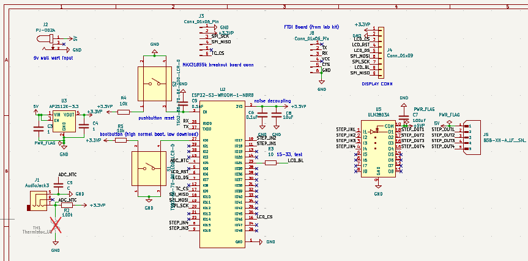 |  |  |

The board carries the ESP32-S3 module, the 3.3 V LDO, the thermistor conditioning and the
stepper driver. It has connectors for the wall adapter, thermocouple breakout, food probe,
stepper and display.

**Power redesign.** The first revision ran on a 3.7 V LiPo battery with a charger board.
The final design moved to a 5 V wall adapter and a single LDO. That meant fewer parts and
no runtime limit, at the cost of efficiency that only mattered on battery. Validation:

- The 3.3 V rail held within ±5% under load, measured with a DMM.
- No brownout resets while the radio was transmitting, checked with an oscilloscope on
  the ESP32's 3.3 V pin.
- The stepper motor received a stable 5 V.

## Sensing and calibration

| Thermocouple (pan) | Thermistor (food) |
| --- | --- |
| 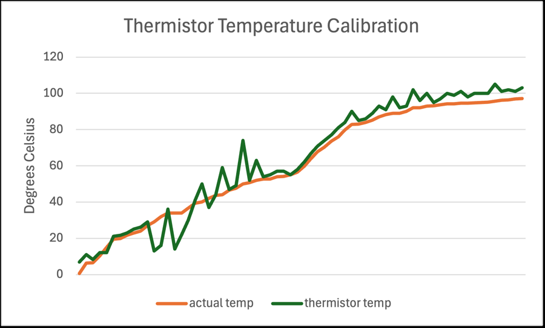 |  |

- **Thermocouple.** Tested with the pan center up to 263 °C, against a 260 °C
  specification. Mounted under the pan, it read about 93 °C below the pan center on
  average, and the gap grew as the pan got hotter. The firmware smooths it with a
  10-sample moving average.
- **Thermistor.** Tested with ice, room-temperature and boiling-water baths, up to
  97.2 °C, against a 93.3 °C specification. It was erratic between about 15 and 50 °C,
  most accurate between 55 and 80 °C, and read a few degrees high above 85 °C. The
  firmware converts readings with a fitted Steinhart–Hart curve.
- **Design choices.**
  - The MAX31855K amplifier was chosen for its built-in cold-junction compensation and
    fault detection: open circuit, short to ground, short to supply.
  - A thermistor probe was chosen over an RTD or a digital sensor for cost and food
    safety, with an RC filter against ADC noise.

## Feedback control


*Control loop design. The "servo + knob" block is the stepper and knob mount in the
built system.*

- **PI rather than PID**, to reduce overshoot. Searing needs a steady pan more than a fast
  one.
- **Conditioning.** Rate limits and a deadband on the controller output keep the motor
  from hunting.
- **Asymmetric response.** Heat goes up gently and comes down aggressively.
- **Safety override.** An over-temperature or a sensor fault forces the knob to OFF,
  whatever the controller output.
- **Pan temperature, not food temperature, is the controlled variable.** The pan responds
  faster and can be controlled directly. Food temperature drives the cooking steps instead.

Measured performance:

| Requirement | Result |
| --- | --- |
| 360° rotation | Rotates continuously in both directions |
| Response time ≤ 0.5 s | Motor response under 3 ms, electrical signal delay under 40 µs |
| Torque to turn a stove knob | 0.05 N·m through the 3D-printed mount |
| Fail safe on sensor fault | Drives the knob to its lowest setting and alerts the user |

The stepper runs open loop: it moves by a commanded angle, with no encoder feedback.
Software can turn the stove off during a fault, but if the motor itself fails, the user
has to pull it off the knob.

## Data processing and state machine

The host-side pipeline turns the raw BLE stream into cooking decisions:

1. **Decoding.** Each 24-byte BLE packet holds a sequence number, a timestamp, pan and
   probe temperatures, and fault flags.
2. **Filtering.** A 3-sample median filter removes spikes, then a 10-sample moving average
   smooths each channel.
3. **Features.** A 50-sample moving linear regression gives the temperature slope in °C
   per minute, and a 50-sample moving variance measures how stable the readings are.
4. **Fault detection.** Faults only count once they persist: sensor dropouts and
   thermocouple faults for 0.5 s, and over-temperature for 3 s. Over-temperature uses
   separate set and clear thresholds.
5. **State machine.** The cook moves through a fixed sequence of states, shown below.

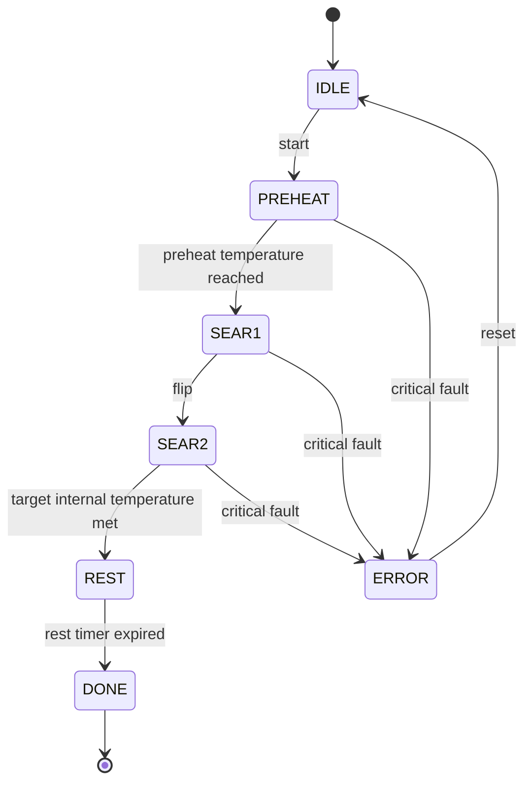

Any active state can also return to IDLE on cancel.

Warnings such as over-temperature are tracked as flags alongside the state, for example
`faults=OVERTEMP` in the test log below. That way a warning can turn the heat down without
abandoning the cook. Critical faults, such as a disconnected sensor, move the machine to
ERROR.

**Two-level safety thresholds.** An over-temperature threshold raises a warning and turns
the heat down, and a higher unsafe maximum triggers a full shutdown. This avoids nuisance
shutdowns while keeping a hard limit.

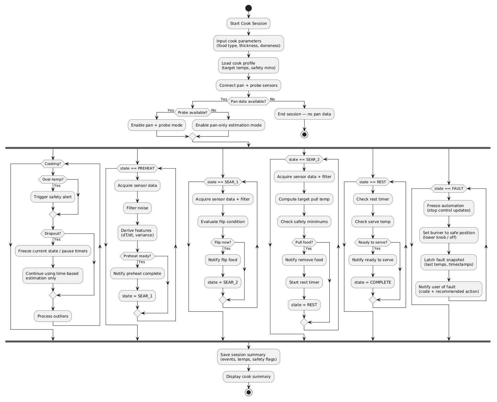

*Design-stage activity diagram for a cook session.*

## Mobile app

| Home | Choose food | Thickness | Doneness | Cooking |
| --- | --- | --- | --- | --- |
| 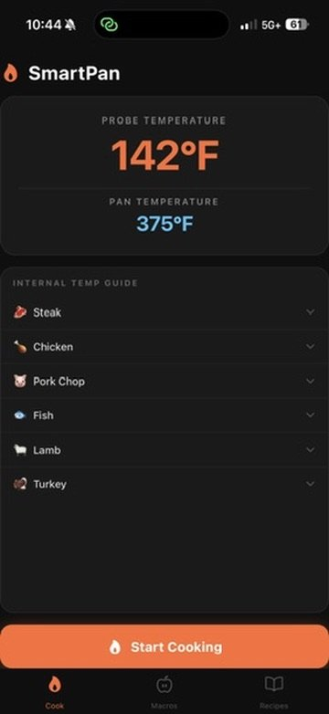 | 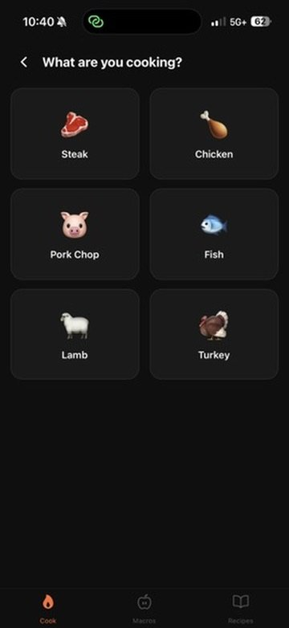 | 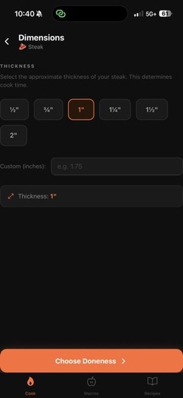 | 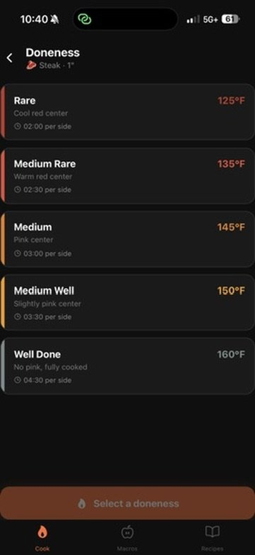 | 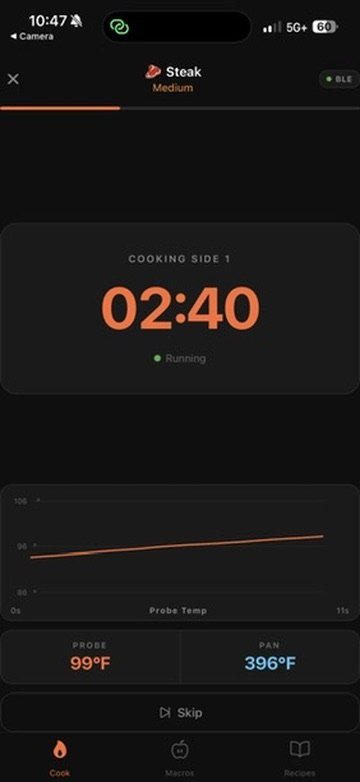 |

*These screenshots come from a build that displayed °F. The final app uses °C, with the
same targets: 135 °F medium rare is 57 °C.*

- **Guided cooking.** Pick a food, its thickness and a target doneness, then follow the
  prompts to preheat, sear, flip, sear again and rest.
- **Live monitoring.** Pan and probe temperatures, a filtered probe-history chart, a
  countdown for each side, and a BLE connection indicator.
- **Macro tracking.** Daily calorie, protein, carb and fat totals against goals. Foods
  come from a UPC barcode scan (Open Food Facts first, then USDA) or a USDA FoodData
  Central search. Recipes can be saved with their macro totals.

### Adaptive flip timer

A fixed cook time is a guess: thickness, starting temperature and pan heat all vary. The
app starts from a calculated time and adjusts it from the probe.

- **Base time.** The base comes from a table of minutes per inch of thickness for each meat
  and doneness. It's scaled inversely by the measured pan temperature against a 190 °C
  calibration point, so a cooler pan gets more time. The time is captured when each side
  starts, so pan drift doesn't jolt a running timer.
- **Early end.** A side ends as soon as the probe reaches its target. Side 1 targets the
  flip temperature, and side 2 targets the final doneness temperature.
- **Late extension.** In the last 30 seconds, if the probe isn't on pace, the timer
  extends to the predicted arrival time: `ETA = (target − current) / slope`. Slopes under
  0.03 °C/s are ignored as noise.
- **Armed-at-entry gate.** Side 2 can only end early if the probe is below target when side
  2 starts. Otherwise, a probe that overshot during side 1 would skip side 2 before it
  had seared.

| Doneness | Flip at | Done at |
| --- | --- | --- |
| Rare | 30 °C | 52 °C |
| Medium rare | 33 °C | 57 °C |
| Medium | 36 °C | 63 °C |
| Medium well | 39 °C | 66 °C |
| Well done | 42 °C | 71 °C |

### Edge-triggered alerts and steps

- **Overtemperature alarm.** At 130 °C the app shows a full-screen "turn down the stove"
  warning with a looping alarm and vibration, and tracks the peak temperature. It re-arms
  only after the pan drops below 125 °C. That 5 °C gap stops readings near the threshold
  from triggering it repeatedly.
- **Preheat.** The preheat step moves on automatically only when the pan *rises through*
  90 °C. If the pan is already hot when the screen opens, the step doesn't skip itself.

### Probe chart filtering

The chart averages incoming samples into one point per second. It rejects values outside
0–200 °C, and jumps of more than 8 °C per second, which is faster than a meat probe can
physically change. A rejected jump is replaced with a blend of the last accepted value and
the recent average.

### Resilient connections

- **Bridge.** It reconnects to the pan after any BLE error, with a 5-second backoff. Each
  reconnect starts a fresh pipeline, so filter state from a dropped session doesn't carry
  over. Notifications go into a queue capped at 200 that drops the oldest packet when
  full, so a slow consumer never blocks the BLE callback.
- **App.** One `TelemetryProvider` at the root of the app owns the only WebSocket, and
  every screen reads from it. It reconnects automatically after 2 seconds and shows a
  live connected or offline indicator.

### Design choices

- **BLE from the pan.** BLE uses little power and needs no Wi-Fi setup on the board, at
  the cost of about 10 m of range. The host relays the data to the phone over the local
  network. The BLE packet rate was traded against current draw, keeping the minimum rate
  the thermal system's response time needs.
- **Probe-driven flips, not fixed timers or a camera.** Fixed timers ignore thickness and
  pan heat, and a camera struggles with steam and smoke.

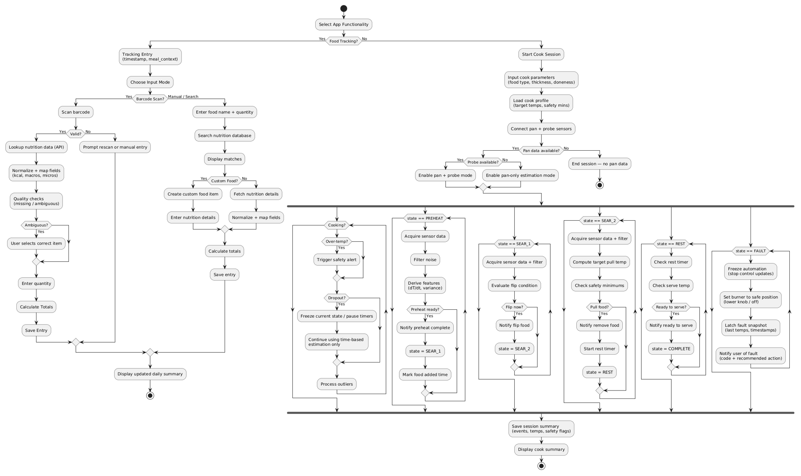

*Design-stage software overview covering the macro-tracking and cooking flows.*

## Testing

**End-to-end cook cycle over BLE.** The state machine stepped through a full cook with
live pan and probe data, logging each transition and every active fault flag:


**BLE throughput.** 59 packets and 1,416 bytes in 60 seconds, about 188 bps against a
100 bps requirement, with no lost, duplicated or reordered packets:

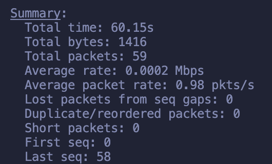

**Fault handling on the LCD.** From left to right: an over-temperature warning, the pan
sensor disconnected, and the food probe disconnected during an over-temperature.

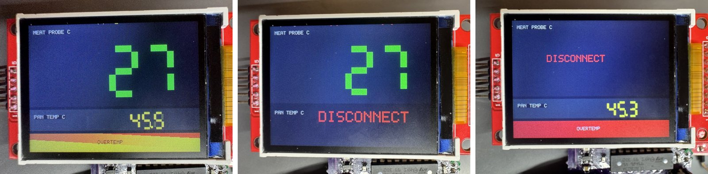

**Without hardware.** `host/mock_telemetry.py` serves the same JSON as the real bridge,
using simulated temperature curves that rise toward a target and level off. It can inject
outlier spikes to test the chart's filter, and has settings for specific cases:

```sh
# Hot pan: confirm cook time scales down
python host/mock_telemetry.py --pan-target 750 --pan-instant

# Fast probe: confirm a side ends early when the probe hits target
python host/mock_telemetry.py --pan-target 750 --pan-instant --probe-tau 25 --probe-delay 0 --no-spike
```

`host/ws_tail.py` prints the live stream one line per packet, for debugging from a
terminal.

## Specification results

| Specification | Result |
| --- | --- |
| Added hardware under 400 g | Met |
| At least 60 minutes of continuous operation | Met |
| Pan sensor functional to 260 °C | Met: tested with the pan center at 263 °C |
| Food sensor functional to 93.3 °C | Met: 97.2 °C |
| Microcontroller powered at 5 V or less | Met |
| BLE throughput of at least 100 bps | Met: about 188 bps |
| Display readable from 2 ft | Met |
| Motor: 360° rotation, ≤ 0.5 s response, enough torque | Met |
| App takes food and doneness inputs, guides the cook, monitors temperatures, prompts transitions | Met |
| Fails safe and alerts the user on sensor malfunction | Met |
| Pan sensor 1 s response and ±5 °C accuracy (reach goal) | Not met: the under-pan mount reads well below the pan center |
| Food sensor ±2 °C accuracy (reach goal) | Not met: erratic below 50 °C, so a fitted calibration curve is used |

## Running it

**App**

```sh
cd SmartPanApp
npm install
cp .env.example .env   # set the bridge URL and, optionally, a USDA API key
npx expo start
```

| Variable | Purpose | Default |
| --- | --- | --- |
| `EXPO_PUBLIC_TELEMETRY_URL` | WebSocket URL of the bridge or mock server | `ws://localhost:8765` |
| `EXPO_PUBLIC_USDA_API_KEY` | [USDA FoodData Central API key](https://fdc.nal.usda.gov/api-key-signup) (free) | `DEMO_KEY`, which allows 30 requests an hour and 50 a day |

On a physical phone, set `EXPO_PUBLIC_TELEMETRY_URL` to the host computer's LAN address,
because `localhost` would point at the phone itself.

**Host, with hardware**

```sh
pip install bleak websockets
git clone https://github.com/sophiezhou1/ece-design.git
python host/ble_ws_bridge.py --data-dir ece-design/data_processing
```

**Host, without hardware**

```sh
pip install websockets
python host/mock_telemetry.py
```

## Repository layout

```
SmartPanApp/
  App.js                       tab + stack navigation, TelemetryProvider at the root
  contexts/TelemetryContext.js shared telemetry state + overtemp alarm
  hooks/useTelemetry.js        WebSocket client with auto-reconnect
  screens/CookingGuideScreen.js step engine and adaptive timers
  components/MeatTempChart.js  filtered live probe chart
  utils/cookingCalculator.js   pan-temperature-scaled cook time
  utils/foodApi.js             USDA + Open Food Facts lookups
  constants/meatData.js        meats, doneness targets, cook-time table
host/
  ble_ws_bridge.py             BLE -> WebSocket bridge
  mock_telemetry.py            hardware-free telemetry simulator
  ws_tail.py                   terminal viewer for the live stream
docs/images/                   photos, diagrams, test results and screenshots
```

## Team

SmartSear was a team senior design project. We worked across the whole stack together
rather than splitting into fixed roles. The embedded firmware and the BLE data pipeline
are in [`sophiezhou1/ece-design`](https://github.com/sophiezhou1/ece-design).
