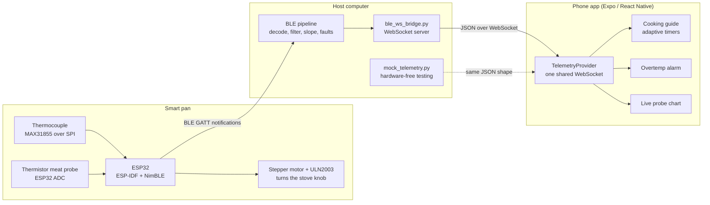

# SmartSear

A sensor-guided pan for searing meat. Sensors in the pan report the pan's surface
temperature and the meat's internal temperature in real time. A phone app turns those
readings into step-by-step cooking guidance: when to add the meat, when to flip it, and
when it's done.

Our team built it as a senior design project, covering the hardware, firmware, host
software and mobile app:

- **Embedded:** an ESP32 reads a thermocouple and a thermistor probe and streams readings
  over Bluetooth Low Energy (BLE). A stepper motor turns the stove's temperature knob.
- **Host:** a Python bridge decodes the BLE stream and serves it to the app as JSON over
  WebSocket.
- **Mobile:** a React Native (Expo) app with adaptive cook timers, a pan overtemperature
  alarm, a live probe chart, and macro and recipe tracking.

## Architecture



The firmware and the BLE decoding, filtering and fault-detection pipeline are in a
companion repo, [`sophiezhou1/ece-design`](https://github.com/sophiezhou1/ece-design).
This repo holds the mobile app and the host-side tools that connect the two.

## How data flows

1. **The pan samples.** The ESP32 reads the pan thermocouple through a MAX31855
   amplifier over SPI. The MAX31855 also flags open-circuit and short faults. The ESP32
   reads the meat probe through its ADC.
2. **BLE sends the readings.** The ESP32 advertises a GATT service and pushes packets to
   the host as notifications.
3. **The pipeline decodes them** (`ble_pipeline.Pipeline`). It turns raw packets into
   temperatures in °C, runs a moving linear regression to get the probe's slope in °C per
   minute, and turns fault bits into readable fault strings.
4. **The bridge broadcasts** (`host/ble_ws_bridge.py`). Every processed sample is sent as
   JSON to every connected WebSocket client. NaN and infinity values are converted to
   `null` first so the payload is always valid JSON.
5. **The app reacts.** One `TelemetryProvider` at the root of the app owns the only
   WebSocket connection. Every screen reads the same live state from it: pan °C, probe °C,
   slope, faults and connection status.

Each message looks like this:

```json
{
  "latest_sample": { "t_us": 1234567, "adc": 41.2, "tc": 187.5 },
  "properties": { "slope": 3.4, "curr_state": "...", "fault": 0, "warn_overtemp": 0 },
  "fault_strings": [],
  "fault_codes": []
}
```

`tc` is the pan temperature and `adc` is the probe temperature, both in °C. `slope` is the
probe's rate of change in °C per minute.

## Engineering highlights

### Adaptive flip timer

A fixed cook time is a guess: meat thickness, starting temperature and pan heat all vary.
The cook guide starts from a calculated time, then adjusts it from live probe data.

- **Base time.** The base time comes from a per-meat, per-doneness table of minutes per
  inch of thickness. It's then scaled inversely by the measured pan temperature against a
  190 °C calibration point, so a cooler pan gets proportionally longer. The value is
  captured when each side starts, so pan-temperature drift doesn't jolt a running timer.
- **Early end.** A side ends as soon as the probe reaches that side's target. Side 1
  targets the flip temperature for the chosen doneness, and side 2 targets the final
  temperature.
- **Late extension.** In the last 30 seconds, if the probe isn't on pace, the timer
  extends to the predicted arrival time:
  `ETA = (target − current) / slope`. Slopes below 0.03 °C/s are ignored as noise.
- **Armed-at-entry gate.** Side 2's early end only works if the probe is *below* the
  target when side 2 starts. Without this, a probe that overshot during side 1 would skip
  side 2 instantly, before that side had seared.

| Doneness | Flip at | Done at |
| --- | --- | --- |
| Rare | 30 °C | 52 °C |
| Medium rare | 33 °C | 57 °C |
| Medium | 36 °C | 63 °C |
| Medium well | 39 °C | 66 °C |
| Well done | 42 °C | 71 °C |

### Edge-triggered safety and step logic

- **Overtemperature alarm.** When the pan reaches 130 °C, the app shows a full-screen
  "turn down the stove" warning with a looping alarm and vibration, and tracks the peak
  temperature. It re-arms only after the pan drops below 125 °C. That 5 °C gap stops
  readings that hover near the threshold from triggering it over and over.
- **Preheat gate.** The preheat step moves on automatically only when the pan *rises
  through* 90 °C. If the pan is already hot when the screen opens, the step doesn't skip
  itself.

### Signal cleanup on the chart

The live probe chart averages incoming samples into one point per second and rejects
implausible values: anything outside 0–200 °C, and jumps of more than 8 °C per second,
which is faster than a meat probe can physically change. A rejected jump is replaced
with a blend of the last accepted value and the recent average. The y-axis keeps a
minimum range so a steady reading doesn't fill the whole chart.

### Resilient connections

- **Bridge.** It reconnects to the pan after any BLE error, with a 5-second backoff. A new
  pipeline is created on each reconnect, so filter state from a dropped session doesn't
  carry over. Notifications go into a queue capped at 200 that drops the oldest packet
  when full, so a slow consumer can never block the BLE callback.
- **No early timeout.** The bridge doesn't drop a connection that's quietly waiting for
  its first packet. Some peripherals are slow to send, and an earlier timeout was killing
  healthy connections.
- **App.** It reconnects automatically after 2 seconds and shows a live connected or
  offline indicator.

### Testing without hardware

`host/mock_telemetry.py` serves the same JSON format as the real bridge, using simulated
temperature curves that rise toward a target and level off. Each new client connection
starts the curve from zero. It can inject periodic outlier spikes to test the chart's
filter, and has settings for specific cases:

```sh
# Hot pan: confirm cook time scales down
python host/mock_telemetry.py --pan-target 750 --pan-instant

# Fast probe: confirm a side ends early when the probe hits target
python host/mock_telemetry.py --pan-target 750 --pan-instant --probe-tau 25 --probe-delay 0 --no-spike
```

`host/ws_tail.py` prints the live stream one line per packet, for debugging the
pipeline from a terminal.

## App features

| Tab | What it does |
| --- | --- |
| **Cook** | Choose the meat (steak, chicken, pork, fish, lamb, turkey), thickness and doneness, then follow the guided steps: preheat, grease, sear (a fat-cap sear first for steak), side 1, flip, side 2, rest |
| **Macros** | Daily calorie, protein, carb and fat tracking with goals. Food search uses USDA FoodData Central; barcode scanning uses Open Food Facts first and falls back to USDA |
| **Recipes** | Build and save recipes from food-database entries, with per-recipe macro totals |

Macro logs, goals and recipes are stored on the device with AsyncStorage.

## Running it

**App**

```sh
cd SmartPanApp
npm install
cp .env.example .env   # set the bridge URL and, optionally, a USDA API key
npx expo start
```

| Variable | Purpose | Default |
| --- | --- | --- |
| `EXPO_PUBLIC_TELEMETRY_URL` | WebSocket URL of the bridge or mock server | `ws://localhost:8765` |
| `EXPO_PUBLIC_USDA_API_KEY` | [USDA FoodData Central API key](https://fdc.nal.usda.gov/api-key-signup) (free) | `DEMO_KEY`, which allows 30 requests an hour and 50 a day |

On a physical phone, set `EXPO_PUBLIC_TELEMETRY_URL` to the host computer's LAN address,
because `localhost` would point at the phone itself.

**Host, with hardware**

```sh
pip install bleak websockets
git clone https://github.com/sophiezhou1/ece-design.git
python host/ble_ws_bridge.py --data-dir ece-design/data_processing
```

**Host, without hardware**

```sh
pip install websockets
python host/mock_telemetry.py
```

## Repository layout

```
SmartPanApp/
  App.js                       tab + stack navigation, TelemetryProvider at the root
  contexts/TelemetryContext.js shared telemetry state + overtemp alarm
  hooks/useTelemetry.js        WebSocket client with auto-reconnect
  screens/CookingGuideScreen.js step engine and adaptive timers
  components/MeatTempChart.js  filtered live probe chart
  utils/cookingCalculator.js   pan-temperature-scaled cook time
  utils/foodApi.js             USDA + Open Food Facts lookups
  constants/meatData.js        meats, doneness targets, cook-time table
host/
  ble_ws_bridge.py             BLE -> WebSocket bridge
  mock_telemetry.py            hardware-free telemetry simulator
  ws_tail.py                   terminal viewer for the live stream
```

## Team

SmartSear was a team senior design project. We worked across the whole stack together
rather than splitting into fixed roles. The embedded firmware and BLE data pipeline are
in [`sophiezhou1/ece-design`](https://github.com/sophiezhou1/ece-design).
