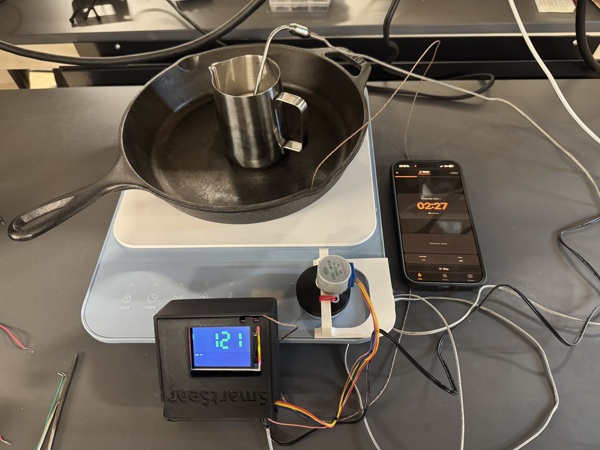
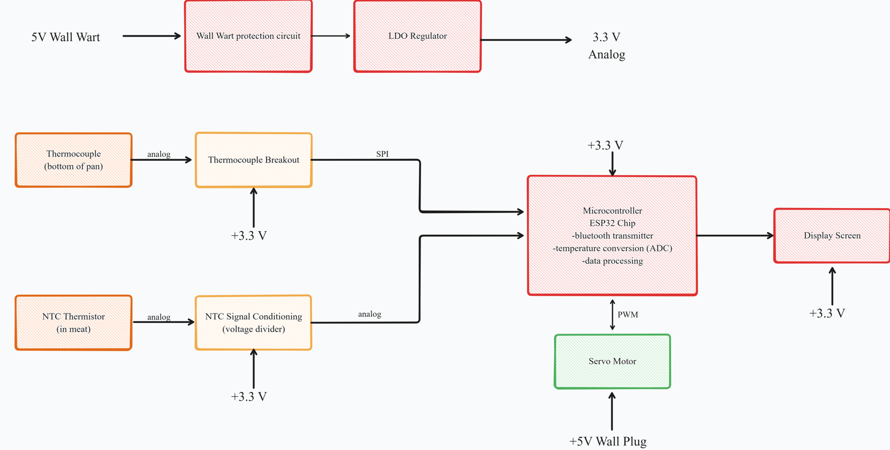
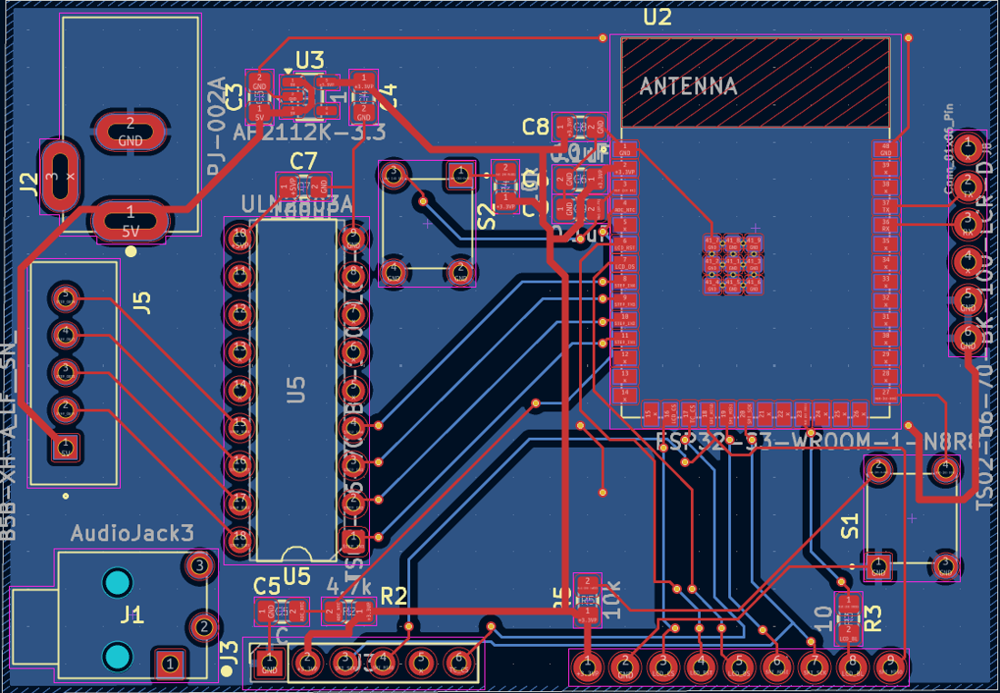
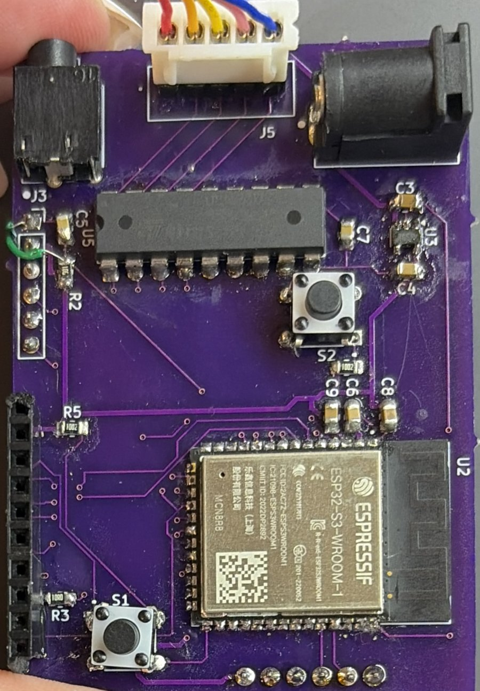
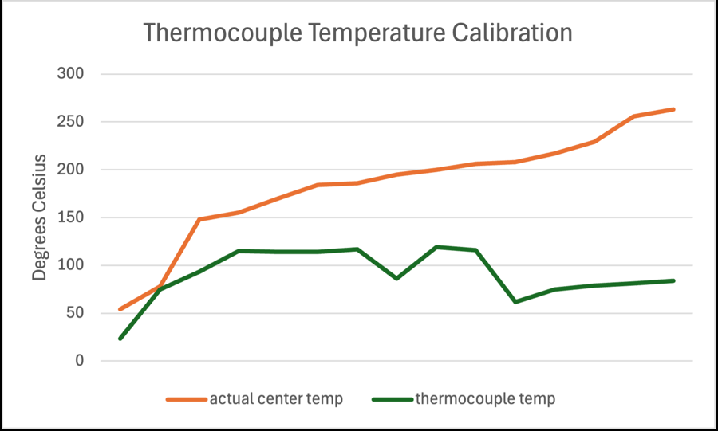
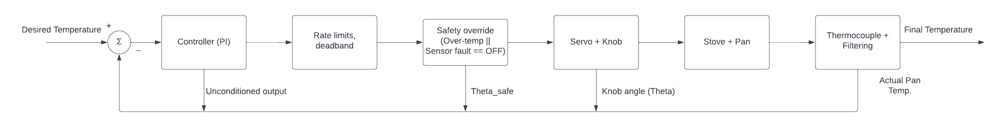
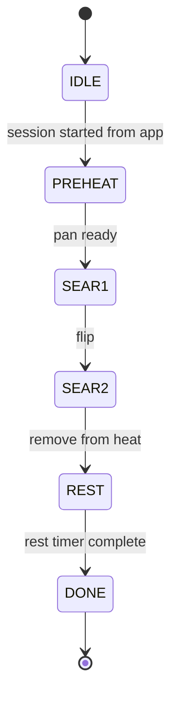
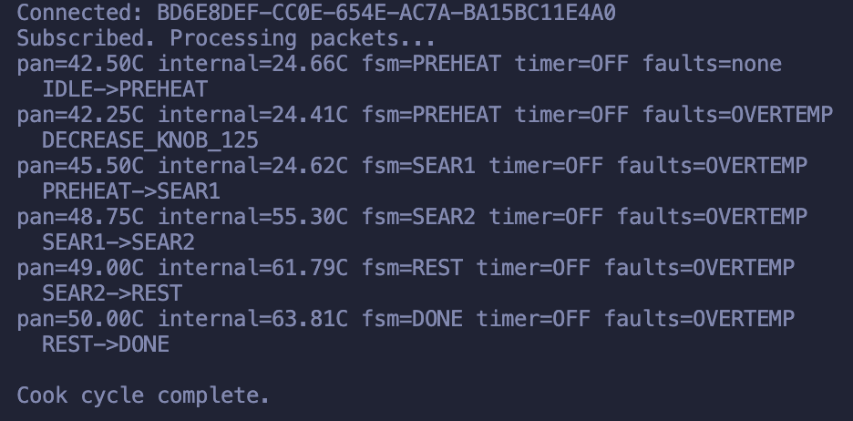

# Smart Sear

*Purdue ECE Senior Design Project*

Closed-loop smart cooking system built on an ESP32. A thermocouple under the pan and a probe in the meat feed a firmware state machine that drives a stepper motor on the stovetop knob, streams live data over Bluetooth Low Energy to a mobile app, and fails safe when a sensor faults or the pan overheats.



## What it does

- **Two temperature inputs:** a Type K thermocouple on the pan and an NTC thermistor probe in the food
- **Closed-loop heat control:** a PI controller turns the stove knob through a stepper motor to hold a target pan temperature
- **Guided cooking:** a firmware state machine walks the cook through preheat, sear, flip, second sear, and rest, and the app prompts each transition
- **Fail-safe behavior:** on over-temperature or a disconnected sensor, the knob is driven to its lowest setting, the LCD shows the fault, and the app switches to manual instructions
- **Nutrition tracking:** the app logs macros from UPC barcode scans or manual entry

## Architecture


| Subsystem | Responsibility |
| --- | --- |
| Data collection | Thermocouple and thermistor sensing, calibration |
| PCB and power | Custom ESP32-S3 board, 5 V input, 3.3 V LDO rail, sensor and display connectors |
| Feedback control | PI control of pan temperature through a stepper-driven stove knob |
| Data processing | Filtering, feature extraction, cooking state machine, safety events, BLE transport |
| Mobile app | Guided cooking, live temperatures, alerts, recipes, macro tracking |

### Hardware



| Component | Part | Interface |
| --- | --- | --- |
| Microcontroller | ESP32-S3-WROOM-1 | BLE to the app |
| Pan sensor | Type K thermocouple + MAX31855K amplifier | SPI |
| Food sensor | NTC thermistor probe (2.5 mm jack), voltage divider + RC filter | ADC |
| Actuator | Geared stepper motor via ULN2803A driver, 3D-printed knob mount | GPIO step patterns |
| Display | Color TFT LCD | |
| Power | 5 V wall adapter, AP2112K-3.3 LDO regulator | |

## Custom PCB

| Schematic | Layout | Assembled |
| --- | --- | --- |
|  |  |  |

The board carries the ESP32-S3 module, the 3.3 V LDO, thermistor conditioning, the stepper driver, and connectors for the wall adapter, thermocouple breakout, food probe, and display.

**Power redesign.** The first revision ran on a 3.7 V LiPo with a charger board. The final design moved to a 5 V wall adapter and a single LDO: fewer parts and no runtime limit, at the cost of efficiency that only mattered on battery. Validation:

- 3.3 V rail held within ±5% under load, measured with a DMM
- No brownout resets while the radio was transmitting, checked with an oscilloscope on the ESP32 3V3 pin
- Stable 5 V delivered to the stepper motor

## Sensing and calibration

| Thermocouple (pan) | Thermistor (food) |
| --- | --- |
|  |  |

- **Thermocouple:** verified to 263 °C (spec: 260 °C). Mounted under the pan, it read about 93 °C below the pan's center on average, so firmware uses the measured offset curve to estimate the center temperature.
- **Thermistor:** verified to 97.2 °C (spec: 93.3 °C) with ice, room-temperature, and boiling water baths. It read high between 15 and 40 °C and was most accurate between 55 and 80 °C, so firmware applies a calibration curve from those measurements.
- **Design choices:** SPI thermocouple amplifier for built-in cold-junction compensation; thermistor probe over an RTD or digital sensor for cost and food safety, with an RC filter against ADC noise.

## Feedback control



- **Controller:** PI rather than PID, to reduce overshoot. Searing needs a steady pan more than a fast one.
- **Conditioning:** rate limits and a deadband on the controller output keep the motor from hunting.
- **Asymmetric response:** heat increases gently and decreases aggressively.
- **Safety override:** an over-temperature or sensor fault forces the knob angle to OFF, regardless of the controller output.
- **Why control pan temperature, not food temperature:** the pan responds faster and is directly controllable. Food temperature drives the cooking state instead.

Measured performance:

| Requirement | Result |
| --- | --- |
| 360° rotation | Rotates continuously in both directions |
| Response time ≤ 0.5 s | Motor response under 3 ms, electrical signal delay under 40 µs |
| Torque to turn a stove knob | 0.05 N·m through the 3D-printed mount |
| Fail safe on sensor fault | Drives knob to lowest setting and alerts the user |

The stepper runs open loop: it moves by a commanded angle with no encoder feedback. Software can turn the stove off during a fault, but if the motor itself fails, the user has to pull it off the knob.

## Data processing and state machine

The firmware turns raw temperature streams into cooking decisions:

1. **Sampling** of pan and food temperatures, with a 5-sample history buffer
2. **Signal processing:** range checks, clipping, and noise filtering
3. **Feature extraction:** temperature slope, short-window variance, stability, and controller rise time and overshoot
4. **Decision logic:** a finite state machine whose transitions are driven by those features and the session parameters from the app (food type, thickness, target doneness)



Faults are tracked as flags alongside the state (for example `faults=OVERTEMP` in the test log below), so a warning can turn the heat down without abandoning the cook.

**Two-level safety thresholds.** An over-temperature threshold raises a warning and turns the heat down. A higher unsafe maximum triggers full shutdown. This avoids nuisance shutdowns while keeping a hard limit.


## Mobile app

| Choose food | Thickness | Doneness | Live cook |
| --- | --- | --- | --- |
|  |  |  |  |

- **Guided cooking:** pick a food, its thickness, and a target doneness, then follow prompts to preheat, flip, remove, and rest
- **Live monitoring:** pan and probe temperatures with a history chart and a time-to-flip countdown
- **Macro tracking:** UPC barcode scan or manual search against a nutrition database, with saved recipes and daily totals

| Monitor |
| --- |
|  |

**Design choices**

- **BLE over Wi-Fi:** lower power and no network setup, at the cost of about 10 m of range. BLE rate was traded against current draw, keeping the minimum rate the thermal system's response time requires.
- **Temperature-driven flips over timers or a camera:** timers ignore thickness, and a camera struggles with steam and smoke.


## Testing

**End-to-end cook cycle over BLE.** The state machine stepped through a full cook with live pan and probe data, logging each transition and active fault flag:



**BLE throughput.** 59 packets and 1,416 bytes over 60 s (about 188 bps against a 100 bps requirement), with zero lost, duplicated, or reordered packets:


**Fault handling on the LCD.** Over-temperature warning, pan sensor disconnected, and food probe disconnected during an over-temperature:


## Specification results

| Specification | Result |
| --- | --- |
| Added hardware under 400 g | Met |
| At least 60 minutes of continuous operation | Met |
| Pan sensor functional to 260 °C | Met (263 °C) |
| Food sensor functional to 93.3 °C | Met (97.2 °C) |
| Microcontroller powered at 5 V or less | Met |
| BLE throughput of at least 100 bps | Met (about 188 bps) |
| Display readable from 2 ft | Met |
| Motor: 360° rotation, ≤ 0.5 s response, enough torque | Met |
| App takes food and doneness inputs, guides the cook, monitors temperatures, prompts transitions | Met |
| Fails safe and alerts the user on sensor malfunction | Met |
| Pan sensor 1 s response and ±5° accuracy (reach goal) | Not met (measured); placement offset compensated in software |
| Food sensor ±2° accuracy (reach goal) | Not met (measured); low-range error compensated with a calibration curve |

## App internals

### Adaptive flip timer

A fixed cook time is a guess: thickness, starting temperature and pan heat all vary. The
app starts from a calculated time and adjusts it from the probe.

- **Base time.** The base comes from a table of minutes per inch of thickness for each meat
  and doneness. It's scaled inversely by the measured pan temperature against a 190 °C
  calibration point, so a cooler pan gets more time. The time is captured when each side
  starts, so pan drift doesn't jolt a running timer.
- **Early end.** A side ends as soon as the probe reaches its target. Side 1 targets the
  flip temperature, and side 2 targets the final doneness temperature.
- **Late extension.** In the last 30 seconds, if the probe isn't on pace, the timer
  extends to the predicted arrival time: `ETA = (target − current) / slope`. Slopes under
  0.03 °C/s are ignored as noise.
- **Armed-at-entry gate.** Side 2 can only end early if the probe is below target when side
  2 starts. Otherwise, a probe that overshot during side 1 would skip side 2 before it
  had seared.

| Doneness | Flip at | Done at |
| --- | --- | --- |
| Rare | 30 °C | 52 °C |
| Medium rare | 33 °C | 57 °C |
| Medium | 36 °C | 63 °C |
| Medium well | 39 °C | 66 °C |
| Well done | 42 °C | 71 °C |

### Edge-triggered alerts and steps

- **Overtemperature alarm.** At 130 °C the app shows a full-screen "turn down the stove"
  warning with a looping alarm and vibration, and tracks the peak temperature. It re-arms
  only after the pan drops below 125 °C. That 5 °C gap stops readings near the threshold
  from triggering it repeatedly.
- **Preheat.** The preheat step moves on automatically only when the pan *rises through*
  90 °C. If the pan is already hot when the screen opens, the step doesn't skip itself.

### Probe chart filtering

The chart averages incoming samples into one point per second. It rejects values outside
0–200 °C, and jumps of more than 8 °C per second, which is faster than a meat probe can
physically change. A rejected jump is replaced with a blend of the last accepted value and
the recent average.

### Resilient connections

- **Bridge.** It reconnects to the pan after any BLE error, with a 5-second backoff. Each
  reconnect starts a fresh pipeline, so filter state from a dropped session doesn't carry
  over. Notifications go into a queue capped at 200 that drops the oldest packet when
  full, so a slow consumer never blocks the BLE callback.
- **App.** One `TelemetryProvider` at the root of the app owns the only WebSocket, and
  every screen reads from it. It reconnects automatically after 2 seconds and shows a
  live connected or offline indicator.

### Testing without hardware

`host/mock_telemetry.py` serves the same JSON as the real bridge,
using simulated temperature curves that rise toward a target and level off. It can inject
outlier spikes to test the chart's filter, and has settings for specific cases:

```sh
# Hot pan: confirm cook time scales down
python host/mock_telemetry.py --pan-target 750 --pan-instant

# Fast probe: confirm a side ends early when the probe hits target
python host/mock_telemetry.py --pan-target 750 --pan-instant --probe-tau 25 --probe-delay 0 --no-spike
```

`host/ws_tail.py` prints the live stream one line per packet, for debugging from a
terminal.

## Running it

**App**

```sh
cd SmartPanApp
npm install
cp .env.example .env   # set the bridge URL and, optionally, a USDA API key
npx expo start
```

| Variable | Purpose | Default |
| --- | --- | --- |
| `EXPO_PUBLIC_TELEMETRY_URL` | WebSocket URL of the bridge or mock server | `ws://localhost:8765` |
| `EXPO_PUBLIC_USDA_API_KEY` | [USDA FoodData Central API key](https://fdc.nal.usda.gov/api-key-signup) (free) | `DEMO_KEY`, which allows 30 requests an hour and 50 a day |

On a physical phone, set `EXPO_PUBLIC_TELEMETRY_URL` to the host computer's LAN address,
because `localhost` would point at the phone itself.

**Host, with hardware**

```sh
pip install bleak websockets
git clone https://github.com/sophiezhou1/ece-design.git
python host/ble_ws_bridge.py --data-dir ece-design/data_processing
```

**Host, without hardware**

```sh
pip install websockets
python host/mock_telemetry.py
```

## Repository layout

```
SmartPanApp/
  App.js                       tab + stack navigation, TelemetryProvider at the root
  contexts/TelemetryContext.js shared telemetry state + overtemp alarm
  hooks/useTelemetry.js        WebSocket client with auto-reconnect
  screens/CookingGuideScreen.js step engine and adaptive timers
  components/MeatTempChart.js  filtered live probe chart
  utils/cookingCalculator.js   pan-temperature-scaled cook time
  utils/foodApi.js             USDA + Open Food Facts lookups
  constants/meatData.js        meats, doneness targets, cook-time table
host/
  ble_ws_bridge.py             BLE -> WebSocket bridge
  mock_telemetry.py            hardware-free telemetry simulator
  ws_tail.py                   terminal viewer for the live stream
docs/images/                   photos, diagrams, test results and screenshots
```

## Team

SmartSear was a team senior design project. We worked across the whole stack together
rather than splitting into fixed roles.
